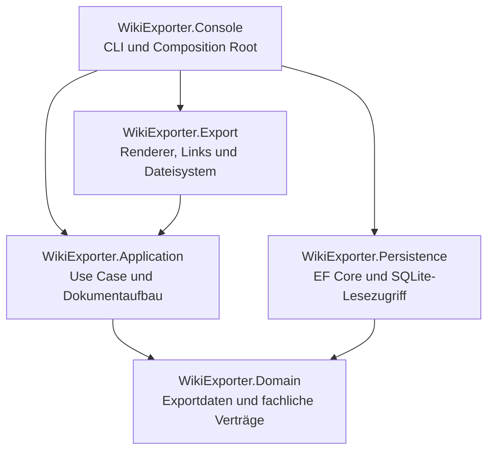

# WikiExporter – Architektur und technische Entscheidungen

## Zweck und Umfang

WikiExporter liest Daten aus einer bestehenden SQLite-Datenbank der EntertainmentInfothek und erzeugt Markdown-Dateien für DokuWiki oder Obsidian. Die Exportausgabe enthält Metadaten und Verweise; Binärbilder werden nicht kopiert. Benutzerspezifische Zuordnungstabellen (`Movie_User`, `Series_User`, `Book_User`, `VideoGame_User`) sind vom Export ausgeschlossen. Details werden exportiert; Notes, Status und LastUpdated gehören nicht zum fachlichen Dokumentinhalt.

## Schichten und Abhängigkeitsrichtung



- **Domain** definiert die exportorientierten Datenmodelle und grundlegenden Exportbegriffe. Sie kennt weder EF Core noch Dateisysteme oder konkrete Markdown-Syntax.
- **Application** steuert einen Export: Auswahl des Entity-Typs und Umfangs, Lesen über Abstraktionen, Sprachwahl und Aufbau eines formatneutralen `MarkdownDocument`. Sie entscheidet nicht, wie ein Renderer eine Wiki-Syntax schreibt.
- **Persistence** bildet die SQLite-Tabellen mit EF Core ab und implementiert die Reader. Tabellennamen und Fremdschlüssel werden explizit konfiguriert. Datenbank-Entities sind mit `Entity` suffixiert, um Kollisionen mit Typnamen zu vermeiden.
- **Export** wandelt das neutrale Dokument in DokuWiki- oder Obsidian-Markdown um und übernimmt Linkauflösung, Dateinamen, Zielpfade und Dateischreiben.
- **Console** liest Kommandozeilenargumente bzw. interaktive Eingaben, baut den Dependency-Injection-Container auf und startet den Anwendungsfall.

Die Composition Root darf Implementierungen aus Persistence und Export zusammenführen. Die Application-Schicht soll keine Abhängigkeit von konkreten EF-Core- oder Rendererklassen erhalten.

## Ablauf eines Exports

1. Die CLI erstellt einen `ExportRequest` mit Entity-Typ, Umfang (`Single` oder `All`), Sprache, Zielformat und optionalem Ausgabeordner.
2. `IExportUseCase` löst Reader und Dokument-Builder über Resolver auf.
3. Ein Reader lädt ein einzelnes Objekt oder verarbeitet alle IDs in begrenzten Batches.
4. Der Builder erzeugt aus den exportierten Daten ein formatneutrales `MarkdownDocument` mit Überschriften, Absätzen, Tabellen, Listen und Links.
5. Der Exportdienst wählt den Renderer, erzeugt den Zieldateinamen und -pfad, löst interne Links auf und schreibt die Datei.
6. Der Anwendungsfall protokolliert den Verlauf und sammelt Fehler pro Element. Bei einem Export aller Elemente soll ein fehlerhaftes Element nicht automatisch die gesamte Verarbeitung abbrechen.

## Exportierte Dokumenttypen und Beziehungen

Die sieben primären Dokumenttypen sind Movie, Series, Episode, Book, VideoGame, Person und Connection. Publication ist Teil des Book-Dokuments; TechnicalSpecification gehört zum VideoGame-Dokument. Series-Dokumente enthalten Episodenreferenzen, während Episoden eigenständige Dokumente bleiben. Personen und Connections sind ebenfalls eigenständige Dokumente. Verweise werden als Links ausgegeben und nicht rekursiv als vollständige Dokumente eingebettet. Connections bilden hierarchische Universen und können weitere Connections sowie Werke referenzieren.

## Sprache und Fallback

Die Auswahl lokalisierter Texte erfolgt nach dem angeforderten Exportmodus:

- **German:** Deutsch → Original → Englisch
- **English:** Englisch → Original → Deutsch
- **Original:** Original → Englisch → Deutsch

Die Sprachwahl gehört zur Anwendungslogik; Renderer sollten keine sprachliche Fallback-Entscheidung treffen.

## Persistenz und Abfrageverhalten

- EF Core bildet die 196 Tabellen und 542 Fremdschlüssel des bereitgestellten Schemas ab.
- Leser verwenden read-only/no-tracking Abfragen und eine Context Factory.
- Beim Export vieler Objekte werden Root-IDs in begrenzten Batches gelesen und zugehörige Daten set-basiert nachgeladen. Ein riesiger `Include`-Graph und ein Query pro einzelner Association-Zeile sollen vermieden werden.
- Verschachtelte Beziehungen müssen in den jeweiligen Exportgraphen berücksichtigt werden, beispielsweise Award → Award-Person, Publication → Publication-Metadaten, TechnicalSpecification → Spezifikationsdetails sowie Text → Autoren/Quellen.
- Die Tests prüfen das EF-Modell anhand der Schemaanzahl. Änderungen am Schema müssen daher sowohl in Entity-Konfigurationen als auch in den Modelltests nachvollzogen werden.

## Dateistruktur und Typkonventionen

Top-Level-Klassen, Records, Structs, Interfaces und Enums liegen jeweils in einer Datei mit dem Typnamen. Verschachtelte `ExportScope.Single` und `ExportScope.All` bleiben aus API-Kompatibilitätsgründen Bestandteile von `ExportScope`; ihre Deklarationen sind über Partial-Dateien organisiert. EF-Entities verwenden den Suffix `Entity`. Die XML-Kommentare im Quellcode beschreiben öffentliche Typen und Member; dieser Architekturtext erklärt zusätzlich die schichtenübergreifenden Entscheidungen.

## Tests und Qualitätskontrollen

- `WikiExporter.Domain.Tests`: grundlegende Exportregeln und Datenmodelle.
- `WikiExporter.Application.Tests`: Sprachfallback, Dokumentaufbau und Use-Case-Verhalten.
- `WikiExporter.Persistence.Tests`: Schema-/FK-Abgleich und Reader-Abfragen gegen SQLite-In-Memory-Daten.
- `WikiExporter.Export.Tests`: Renderer, Links, Pfade und Dateisystem-Schutz.
- `WikiExporter.Console.Tests`: Argumentparser und Composition Root.

Empfohlene lokale Prüfung nach Änderungen:

```bash
dotnet clean
dotnet build
dotnet test
```

## Bewusste Grenzen

- Es werden keine Bilddateien aus der Datenbank exportiert; Bildmetadaten und Referenzen können im Dokument erscheinen.
- Referenzen erzeugen Links, keinen rekursiven Exportlauf.
- Die Persistence-Schicht ist für Datenzugriff zuständig; sie formatiert kein Markdown.
- Renderer sind für die Syntax des Zielformats zuständig; sie verändern nicht die zugrunde liegenden Exportdaten.
